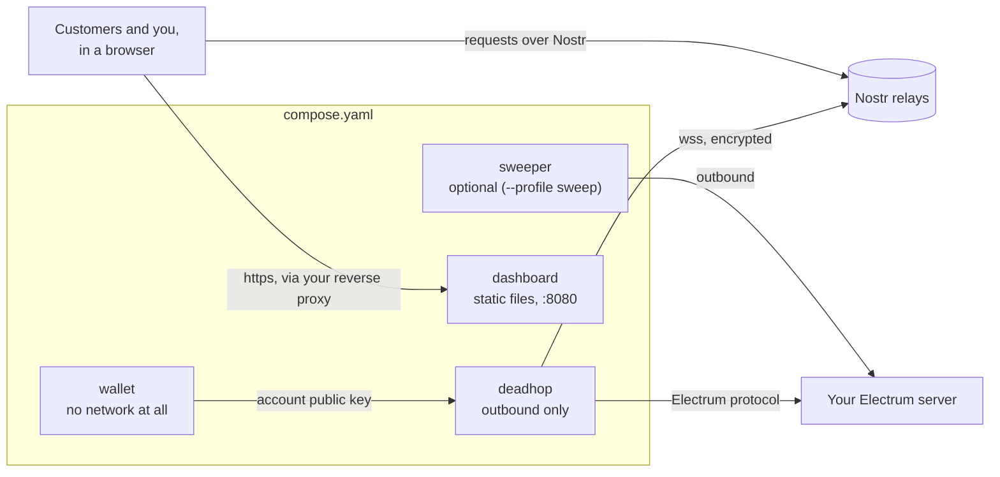
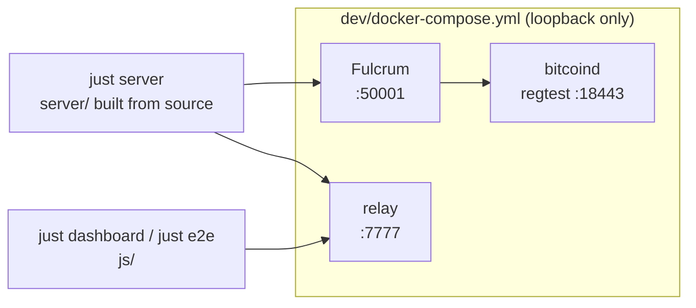

<div align="center">

<picture>
  <source media="(prefers-color-scheme: dark)" srcset="https://deadhop.run/docs/mark-fog.svg">
  
</picture>

# deadhop stack

Run a [deadhop](https://deadhop.run) payment service with Docker Compose, or develop one on a
local regtest chain.

[](https://github.com/deadhop/stack/actions/workflows/ci.yml)
[](LICENSE)
[](https://deadhop.run/docs/deploy-compose.html)

</div>

This repository has no code of its own. It holds what runs the components together:

| Path | What |
| --- | --- |
| `compose.yaml` | Production: the offline wallet, the payment service, the dashboard and the optional sweeper. Docker builds each image from its repository on GitHub, so this file is all a deployment needs. |
| `dev/docker-compose.yml` | Development only: a regtest bitcoind, Fulcrum and a private relay, all on loopback. |
| `scripts/` | The development scripts behind `just up`, `just server` and `just pay`. |

## Run deadhop



The `wallet` container generates a wallet on first start and hands only its account key to the
service; it has no network. The service makes only outbound connections. Every container has a
read-only root filesystem, no Linux capabilities and a memory limit, and none publishes a port
to the host unless you add one.

You need Docker with Compose v2, and an [Electrum server](https://deadhop.run/docs/electrum.html)
the service can reach (Fulcrum or electrs on your node).

```sh
git clone https://github.com/deadhop/stack && cd stack
```

Write `.env` next to `compose.yaml` (it is gitignored):

```sh
DEADHOP_ELECTRUM=tls://node.lan:50002          # your Electrum server
DEADHOP_ELECTRUM_CERT_SHA256=<fingerprint>     # its certificate, pinned
DEADHOP_ADMINS=npub1…                          # you: the Nostr key you sign in to the dashboard with
# DEADHOP_XPUB=zpub6…                          # optional: your own wallet's account key, instead of a generated one
```

```sh
docker compose up -d --build
docker compose logs deadhop | grep -E "serving|first receive address"
```

The first build takes several minutes; it builds each image from its repository's `main` branch.
`git pull` here picks up changes to the compose file itself.

| Next | |
| --- | --- |
| [Run it with Docker Compose](https://deadhop.run/docs/deploy-compose.html) | Every step: start it, write down the recovery phrase, check the first address, reach the dashboard, sign in, update |
| [Your first real payment](https://deadhop.run/docs/first-payment.html) | A tutorial: from an empty server to an invoice paid and seen in Sparrow |
| [Deployment setups](https://deadhop.run/docs/setups.html) | Ten setups, from one box next to your node to a hidden service |
| [Sweep to your cold wallet](https://deadhop.run/docs/wallet/sweep.html) | Turn on the sweeper |
| [Production checklist](https://deadhop.run/docs/deployment.html) | Everything to check before the first real payment |

## Develop

Requirements: Rust, Node 24, Docker and [`just`](https://github.com/casey/just).

```sh
git clone https://github.com/deadhop/stack && cd stack
just clone       # server/, js/, lnaddr/, wallet/ and relay/ next to these files (gitignored)
just install     # the JavaScript workspace in js/
just up          # regtest bitcoind + Fulcrum + private relay, a funded "miner" and a "merchant" wallet
just server      # build and run deadhop on the stack; writes js/dashboard/public/config.json
just dashboard   # serve the dashboard at http://127.0.0.1:4173
just pay <address> <sats>   # pay a regtest invoice from the miner wallet
just e2e         # real payments in Chrome: dashboard, console, client, every framework's components
just down        # remove the stack and its chain data
```



The scripts read `.env.local` here on every run (gitignored), for example `DEADHOP_ADMINS=npub1…`
or `DOCKER_CONTEXT=orbstack`. The service's database and keys go to `data/dev/`. The
step-by-step tutorial: [Try it on regtest](https://deadhop.run/docs/quickstart.html).

The development stack is for development only: its RPC password is fixed, its wallets are hot,
and its relay has no authentication. Do not adapt `dev/docker-compose.yml` for production.

`just check` validates both compose files and runs shellcheck on the scripts; CI runs the same.

## The components

| Repository | What it holds |
| --- | --- |
| [deadhop/server](https://github.com/deadhop/server) | The payment service |
| [deadhop/js](https://github.com/deadhop/js) | `@deadhop/client`, the framework components, the dashboard and the console |
| [deadhop/wallet](https://github.com/deadhop/wallet) | The sweeper |
| [deadhop/lnaddr](https://github.com/deadhop/lnaddr) | A Lightning address for a node with no public address |
| [deadhop/relay](https://github.com/deadhop/relay) | A Nostr relay for one deadhop service |
| [deadhop/site](https://github.com/deadhop/site) | https://deadhop.run and every component's docs |
| [deadhop/brand](https://github.com/deadhop/brand) | Logo, icons, fonts |

## Agent skills

This repository ships [agent skills](https://deadhop.run/docs/skills.html) for Claude Code,
Codex, Cursor and other agents that read `SKILL.md`:

```sh
npx skills add deadhop/stack
```

| Skill | Use it to |
| --- | --- |
| `deadhop-stack-deploy` | run deadhop in production with `compose.yaml`: `.env`, first start, recovery phrase, first address, dashboard, sweeper, updates |
| `deadhop-stack-regtest` | run the local regtest stack: `just up`, `just server`, `just dashboard`, `just pay`, `just e2e` |

Install one with `--skill <name>`. Every deadhop skill is listed on
[Agent skills](https://deadhop.run/docs/skills.html).

## Contributing

Changes to `compose.yaml` are changes to what every deployment runs: describe what an operator
must do, if anything, in the pull request. Doc changes go to
[deadhop/site](https://github.com/deadhop/site).

## License

[MIT](LICENSE).
